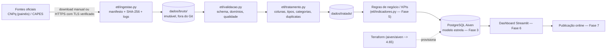

# Arquitetura



## Estado por etapa (2026-11-05)

| Etapa | Arquivo | Estado |
|---|---|---|
| Ingestão | `etl/ingestao.py`, `etl/fontes.py` | **Pronta e testada** (sem dados oficiais ainda) |
| Logging | `etl/logging_config.py` | Pronto (`logs/pipeline.log`) |
| Validação / qualidade | `etl/validacao.py` | **Pronta e testada** |
| Tratamento | `etl/tratamento.py` | **Pronto e testado** (esquema real pendente dos dados) |
| Indicadores | `etl/indicadores.py` | Não iniciado (depende do schema real) |
| Carga PostgreSQL / modelagem | `etl/carga_postgresql.py`, DDL | Não iniciado **de propósito** (sem schema real) |
| Terraform | `terraform/*.tf` | Preparado; **não validado com `terraform validate`** (CLI ausente) e **não aplicado** |
| Dashboard | `dashboard/` | Fora do escopo desta etapa |

## Decisões

* **Bruto imutável + manifesto:** `dados/bruto/manifesto_ingestao.json` guarda origem, data, tamanho e SHA-256; alterações posteriores
  são detectadas (`IngestaoErro`).
* **Leitura como texto:** todo CSV/XLSX entra como `string`; a tipagem é explícita em `tratamento.py` (evita coerções silenciosas).
* **TLS sempre verificado.** Redes com CA própria usam `CA_BUNDLE`; não existe flag para desativar a verificação.
* **Reuso dos scripts originais:** `ler_csv.py`, `tratar_csv.py`, `tratar_csv_com_erros.py` e `exercicio_pandas.py` permanecem intactos
  (exercícios); a lógica de padronização/tipagem foi generalizada em `etl/tratamento.py`. O teste original
  `tests/test_tratamento.py` continua passando sem modificações.

## Terraform (preparação)

* Provider `aiven/aiven`, versão `~> 4.65` (última no Registry em 2026-11-05: 4.65.1). Atributos usados (`plan`, `project`,
  `cloud_name`, `service_name`, `termination_protection`, `pg_user_config.pg_version`, `pg_user_config.ip_filter_object`,
  `service_host/port/username/password/uri`) e `aiven_pg_database` foram conferidos na documentação do provider v4.65.1 no GitHub.
* **Não verificado:** o nome do plano gratuito (`free-1-1gb`) — vem de busca web; a documentação da Aiven bloqueou o acesso automatizado (HTTP 403).
  O Free Tier pode não estar disponível para a conta/região. O plano é variável (`var.plano`).
* Segredos: `AIVEN_API_TOKEN` por variável de ambiente; `*.tfvars` e `*.tfstate` ignorados; a senha sai como `output` sensível.

Procedimento (somente após autorização explícita, **nunca `destroy`**):

```powershell
$env:AIVEN_API_TOKEN = "<token>"
cd terraform
Copy-Item terraform.tfvars.example terraform.tfvars   # edite aiven_project
terraform init
terraform fmt -check
terraform validate
terraform plan -out plano.tfplan     # revisar
# terraform apply plano.tfplan       # NÃO executado nesta fase
```
