# Arquitetura

## 1. Visão atual (Fase 2)

```mermaid
flowchart LR
    A["CNPq — Painel Lattes 2023<br/>Download - Tabela.xlsx"] -->|"download manual + manifesto SHA-256"| B["etl/ingestao.py<br/>dados/bruto/ imutável"]
    B --> C["etl/leitor_lattes.py<br/>resolução de mergeCells"]
    C --> D["etl/tratamento_lattes.py<br/>tipos, categorias, duplicatas"]
    D --> E["dados/tratado/<br/>painel_lattes_2023_tratado.csv"]
    D --> F["docs/relatorio_qualidade_lattes_2023.json<br/>docs/linhagem/linhagem_lattes_2023.json"]
    E --> G["etl/carga_lattes.py<br/>lotes, transação, idempotência"]
    G --> H[("PostgreSQL Aiven<br/>observatorio.lattes_analytics.perfil_pesquisadores_lattes_2023")]
    H --> I["etl/consultas_validacao_lattes.sql<br/>validação ponderada"]
    I --> J["Próximas fases:<br/>indicadores e dashboard"]
    T["Terraform aiven/aiven ~> 4.65<br/>imports.tf"] -.gerencia.-> H
```

## 2. Estado por etapa (2026-11-06)

| Etapa | Arquivo | Estado |
|---|---|---|
| Ingestão | `etl/ingestao.py`, `dados/bruto/manifesto_ingestao.json` | **Concluída**: base Lattes importada e registrada com SHA-256 |
| Leitura especializada | `etl/leitor_lattes.py` | **Concluída**: 37.983 mergeCells resolvidos |
| Tratamento / qualidade | `etl/tratamento_lattes.py`, `etl/validacao.py` | **Concluída**: 25.820 linhas, 26.009 ponderados |
| Linhagem | `etl/linhagem.py`, `docs/linhagem/linhagem_lattes_2023.json` | **Concluída**: origem, versão original, versão tratada e decisões |
| Modelagem / carga | `etl/ddl_lattes_2023.sql`, `etl/carga_lattes.py` | **Concluída**: tabela única desnormalizada + índices; carga idempotente |
| Validação SQL | `etl/consultas_validacao_lattes.sql` | **Concluída**: 25.820 linhas e 26.009 ponderados |
| Terraform | `terraform/*.tf`, `terraform/imports.tf` | **Aplicado/importado** na Aiven; estado local não versionado |
| Indicadores de fomento | — | Não iniciado; depende de fonte com propostas submetidas/aprovadas |
| Dashboard | `dashboard/` | Fora do escopo desta fase |

## 3. Decisões de arquitetura

1. **Bruto imutável + manifesto:** `dados/bruto/manifesto_ingestao.json` guarda
   origem, data, tamanho e SHA-256. Alterações posteriores são detectáveis.
2. **Leitura como texto e tipagem explícita:** o XLSX é lido com resolução de
   mergeCells; a tipagem é aplicada no ETL, evitando coerções silenciosas.
3. **TLS sempre verificado:** a conexão PostgreSQL usa `sslmode=require`;
   redes com CA própria podem usar `CA_BUNDLE`. Não existe flag para desativar
   a verificação.
4. **Modelo físico desnormalizado:** para 25.820 linhas, uma tabela analítica
   com 40 colunas + chave substituta evita JOINs e cabe com folga no Free Tier.
   O modelo estrela permanece como proposta conceitual de evolução, não como
   implementação atual. Ver [`docs/modelagem_postgresql.md`](modelagem_postgresql.md).
5. **Carga idempotente e não destrutiva:** `etl/carga_lattes.py` só aceita
   `append`; se a tabela já contém os valores esperados, não duplica; se há
   divergência, aborta com rollback.
6. **Separação entre perfil e fomento:** a base Lattes é um retrato de perfil
   de mestres/doutores; taxas de aprovação/contemplação exigem o Painel PQ ou
   outra fonte oficial. Ver [`docs/regras_negocio.md`](regras_negocio.md).

## 4. Segurança e governança

- `.env`, `*.tfvars`, `*.tfstate`, planos e chaves são ignorados pelo Git.
- O provider Terraform lê `AIVEN_TOKEN` do ambiente; o script auxiliar aceita
  `AIVEN_API_TOKEN` apenas como fallback legado.
- Nenhum output sensível do Terraform deve ser gravado em JSON ou commitado.
- Dados brutos e tratados são ignorados pelo Git; a redistribuição depende da
  licença aplicável. Ver [`docs/lgpd.md`](lgpd.md).

## 5. Reprodução

O roteiro completo, em PowerShell, está em
[`docs/reproducao_fase2.md`](reproducao_fase2.md). Ele cobre download,
manifesto, ETL, `.env`, Terraform, carga, validação SQL e testes.
