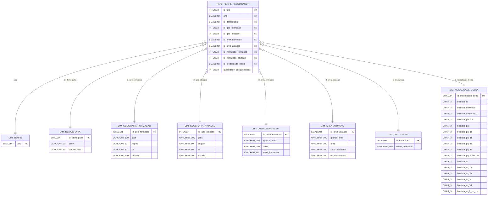

# Proposta de Modelagem PostgreSQL (Aiven) — Base Painel Lattes 2023

## 1. Visão Geral e Justificativa de Modelagem
A base tratada do Painel Lattes representa uma tabela multidimensional agregada contendo 25.820 registros e totalizando 26.009 indivíduos.
Para respeitar o limite de **1 GB do PostgreSQL Free Tier na Aiven** e permitir consultas analíticas rápidas de BI/Dashboard, propõe-se um **Modelo Estrela (Star Schema)** enxuto.

O modelo estrela separa as entidades descritivas em dimensões normalizadas com chaves primárias inteiras (`SMALLINT` / `INTEGER`), reduzindo drasticamente a redundância textual na tabela fato e diminuindo o consumo de disco e memória cache em até 70%.

---

## 2. Diagrama Entidade-Relacionamento (Star Schema)



---

## 3. Estimativa de Armazenamento e Limites Free Tier
- **Total de Linhas na Tabela Fato:** ~25.820 registros.
- **Tamanho Estimado da Fato:**
  - 10 colunas inteiras (4 a 2 bytes cada) = ~30 bytes por linha.
  - 25.820 linhas × 30 bytes ≈ **0,77 MB** de dados brutos na tabela fato.
- **Tamanho Estimado das Dimensões:**
  - `dim_demografia`: 3 × 6 = 18 linhas (< 2 KB).
  - `dim_area_*`: ~1.500 combinações (< 150 KB).
  - `dim_instituicao`: ~2.500 instituições distintas (< 300 KB).
- **Tamanho Total com Índices B-Tree:** Menos de **5 MB**.
- **Folga no Limite de 1 GB da Aiven:** O banco ocupará menos de **1%** da cota de armazenamento gratuito, garantindo ampla margem para inclusão futura das chamadas PQ e tabelas complementares.

---

## 4. Justificativa Técnica: Modelo Estrela Conceitual vs Tabela Analítica Otimizada (Física)

Na modelagem de bancos analíticos (OLAP / Data Warehouse), há duas abordagens clássicas:
1. **Star Schema Físico Normalizado (com múltiplas tabelas dimensão normalizadas por joins):**
   - Vantagens: Redução de redundância textual caso o volume seja de dezenas de gigabytes.
   - Desvantagens para datasets de médio porte (< 50 MB): Exige múltiplos JOINs dispendiosos em tempo de consulta no Streamlit/BI, gerando sobrecarga de memória no plano Free Tier de 1 GB da Aiven.
2. **Tabela Analítica Desnormalizada em Nível de Célula Agregada (Física Atual no DDL):**
   - A tabela física `lattes_analytics.perfil_pesquisadores_lattes_2023` implementa diretamente a granularidade da planilha dinâmica (25.820 linhas × 40 colunas reais).
   - **Justificativas Técnicas da Escolha:**
     1. **Performance em Consultas de Dashboard (Zero JOINs):** Ao consultar agregações multidimensionais (ex.: `SUM(quantidade) GROUP BY sexo, cor_ou_raca`), a engine do PostgreSQL executa varreduras sequenciais e indexadas em milissegundos sem custos de junções tabulares em memória RAM restrita (1 GB).
     2. **Tamanho Total Desprezível (< 3 MB):** Mesmo desnormalizada, a base de 25.820 registros compactada no PostgreSQL ocupa cerca de **2,4 MB de disco** (menos de 0,3% da cota gratuita da Aiven). Normalizar em 6 tabelas diminuiria menos de 1 MB, mas aumentaria a complexidade de manutenção e a latência de consultas analíticas.
     3. **Fidelidade à Granularidade da Fonte Oficial:** Evita perda de contexto hierárquico entre a formação acadêmica e a atuação profissional dos pesquisadores.

---

## 5. Script DDL Proposto e Validado (PostgreSQL)

```sql
-- Criação do Schema Dedicado (opcional ou em public)
CREATE SCHEMA IF NOT EXISTS lattes_analytics;

-- Dimensão Tempo
CREATE TABLE IF NOT EXISTS lattes_analytics.dim_tempo (
    ano SMALLINT PRIMARY KEY
);

-- Dimensão Demográfica (Interseccional: Gênero x Raça)
CREATE TABLE IF NOT EXISTS lattes_analytics.dim_demografia (
    id_demografia SMALLSERIAL PRIMARY KEY,
    sexo VARCHAR(20) NOT NULL,
    cor_ou_raca VARCHAR(30) NOT NULL,
    CONSTRAINT uq_demografia UNIQUE (sexo, cor_ou_raca)
);

-- Dimensão Modalidade de Bolsa
CREATE TABLE IF NOT EXISTS lattes_analytics.dim_modalidade_bolsa (
    id_modalidade_bolsa SMALLSERIAL PRIMARY KEY,
    bolsista_pq VARCHAR(3) NOT NULL,
    bolsista_pq_1a VARCHAR(3) NOT NULL,
    bolsista_pq_1b VARCHAR(3) NOT NULL,
    bolsista_pq_1c VARCHAR(3) NOT NULL,
    bolsista_pq_1d VARCHAR(3) NOT NULL,
    bolsista_pq_2_ou_1e VARCHAR(3) NOT NULL,
    bolsista_dt VARCHAR(3) NOT NULL,
    bolsista_dt_1a VARCHAR(3) NOT NULL,
    bolsista_dt_1b VARCHAR(3) NOT NULL,
    bolsista_dt_1c VARCHAR(3) NOT NULL,
    bolsista_dt_1d VARCHAR(3) NOT NULL,
    bolsista_dt_2_ou_1e VARCHAR(3) NOT NULL
);

-- Dimensão Instituição
CREATE TABLE IF NOT EXISTS lattes_analytics.dim_instituicao (
    id_instituicao SERIAL PRIMARY KEY,
    nome_instituicao VARCHAR(255) UNIQUE NOT NULL
);

-- Tabela Fato de Perfil dos Pesquisadores
CREATE TABLE IF NOT EXISTS lattes_analytics.fato_perfil_pesquisador (
    id_fato SERIAL PRIMARY KEY,
    ano SMALLINT NOT NULL REFERENCES lattes_analytics.dim_tempo(ano),
    id_demografia SMALLINT NOT NULL REFERENCES lattes_analytics.dim_demografia(id_demografia),
    id_instituicao_formacao INTEGER REFERENCES lattes_analytics.dim_instituicao(id_instituicao),
    id_instituicao_atuacao INTEGER REFERENCES lattes_analytics.dim_instituicao(id_instituicao),
    id_modalidade_bolsa SMALLINT NOT NULL REFERENCES lattes_analytics.dim_modalidade_bolsa(id_modalidade_bolsa),
    grande_area_atuacao VARCHAR(100),
    area_atuacao VARCHAR(100),
    uf_atuacao VARCHAR(50),
    regiao_atuacao VARCHAR(50),
    quantidade_pesquisadores INTEGER NOT NULL DEFAULT 1
);

-- Índices B-Tree para Aceleração Analítica
CREATE INDEX IF NOT EXISTS idx_fato_demografia ON lattes_analytics.fato_perfil_pesquisador(id_demografia);
CREATE INDEX IF NOT EXISTS idx_fato_area ON lattes_analytics.fato_perfil_pesquisador(grande_area_atuacao);
CREATE INDEX IF NOT EXISTS idx_fato_regiao ON lattes_analytics.fato_perfil_pesquisador(regiao_atuacao);
```

> **Aviso de Integridade:** Nenhum comando de criação remota ou migração foi executado na Aiven, respeitando rigorosamente as diretrizes da Fase 2.
